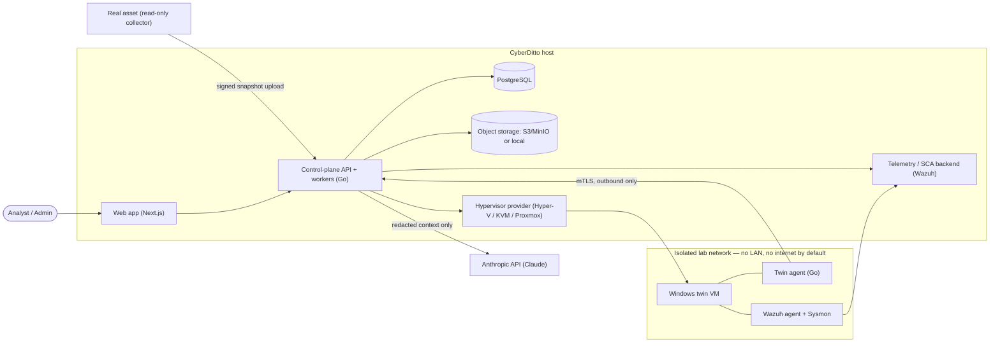
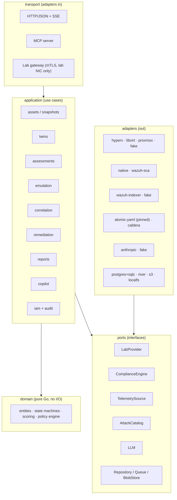

# CyberDitto

**Build a configuration-faithful digital twin of a Windows endpoint. Attack the twin, not production. Prove the fix actually works before it ever touches a real machine.**

[](https://github.com/sshreyx1/CyberDitto/actions/workflows/ci.yml)
[](https://github.com/sshreyx1/CyberDitto/actions/workflows/security.yml)
[](https://github.com/sshreyx1/CyberDitto/actions/workflows/commit-hygiene.yml)
-blueviolet)


> **For authorised use only** — on systems you own or have explicit written permission to test. See [Safety model](#safety-model).

---

## Table of contents

- [What it does](#what-it-does)
- [Why it exists](#why-it-exists)
- [Status](#status)
- [Architecture](#architecture)
- [Security](#security)
- [Safety model](#safety-model)
- [Tech stack](#tech-stack)
- [Repository layout](#repository-layout)
- [Running it locally](#running-it-locally)
- [Roadmap](#roadmap)
- [Documentation](#documentation)
- [License](#license)

---

## What it does

CyberDitto turns one question — *"how exposed is this Windows machine, really?"* — into a closed loop instead of a one-off scan:

```
Collect → Build Twin → Assess (CIS-style) → Attack (ATT&CK) → Correlate → Remediate on Twin → Re-test → Export fix for Prod → Report
```

1. **Collect** — a signed, read-only collector snapshots a real machine's configuration (policy, services, firewall, Defender, patch level — never content or credentials).
2. **Build a twin** — that snapshot becomes an isolated VM that mirrors the real machine's *configuration*, scored with a transparent **Fidelity Score** against what it couldn't replicate.
3. **Assess** — CIS-style controls run against the twin, each failure backed by evidence, not a checkbox.
4. **Attack** — MITRE ATT&CK-mapped techniques run against the twin and are classified **blocked / detected / logged-only / missed**.
5. **Correlate** — failed controls are linked to the techniques that actually exploited them, ranked by evidence-weighted priority — not guesswork.
6. **Remediate, re-test, export** — a fix is applied to the *twin*, the same attack is re-run to prove the fix works, and only then is a reviewed script bundle exported for production. Nothing touches the real machine automatically.

An AI layer ("Ditto Copilot," Claude-powered) sits on top to explain findings, draft remediation, and answer "why did this technique succeed?" — grounded in the run's own evidence, with every mutating action gated behind human approval.

## Why it exists

This is a ground-up rewrite ("v2") of an earlier prototype. The honest audit of that prototype is in [`docs/MASTER_PLAN.md §2`](docs/MASTER_PLAN.md#2-audit-of-the-v1-project-what-is-actually-in-the-zip) — in short, it described CIS benchmarking, ATT&CK emulation, gap analysis and one-click remediation, but shipped a scan script with hardcoded `true` results, a JWT **signed in the browser** with a secret bundled to every visitor, and every API endpoint unauthenticated. Those findings are the reason this rewrite exists, and why §6 below reads the way it does.

| What v1 claimed | What v1 actually had | What v2 does about it |
|---|---|---|
| CIS benchmark automation | Hand-rolled script hardcoding `firewall.enabled = true` | Wazuh SCA / native engine, every result backed by evidence |
| Authenticated API | No-op auth middleware — every endpoint open | Deny-by-default authZ, server-side sessions, authZ-matrix tests |
| A "digital twin" | A stock 2021 Windows box plus a JSON file dropped on `C:\` | Real config replication, measured **Fidelity Score** |
| Attack emulation | Hardcoded arrays + a `setInterval` fake progress bar | Pinned Atomic Red Team catalog + Caldera, run against the twin only |
| Secure secrets | Client-signed JWT, real MACs/IPs committed to the repo | Argon2id + passkeys, pseudonymisation, `.gitignore`/CI secret scanning |

Full defect list, severities, and what's actually worth reusing: [`docs/MASTER_PLAN.md §2.3`](docs/MASTER_PLAN.md#23-defects-and-security-findings-all-must-be-designed-out-in-v2).

## Status

**Phases 1–3 working end to end; the real hypervisor lab is next.** Built in public, phase by phase; the live checklist is [`docs/PROGRESS.md`](docs/PROGRESS.md).

Built and verified so far:

- **Collector** — a read-only, consent-gated Go binary reading 20 Windows configuration categories (UAC, LSA, RDP/NLA, SMB, Defender, firewall, VBS/HVCI, accounts, patches, Secure Boot, BitLocker, …). Anything it can't read is reported as *unknown* with the reason, never defaulted. Optional pseudonymisation of hostnames and account names with a local-only reverse map.
- **Assets and snapshots** — upload the collector's file; strict schema validation, immutable versions, SHA-256 of the exact bytes received, optional digest check against what the collector printed.
- **Compliance engine** — 28 controls with CyberDitto's own IDs and wording, each verdict backed by the observed values from the snapshot, unset settings judged against Windows' documented defaults, and a weighted posture score that excludes unknowns rather than counting them as passes.
- **Twins** — persistent twin lifecycle with live build progress over SSE (built by a `fake` lab provider until the real Hyper-V provider lands).
- **Platform security** — Postgres Row-Level Security on every workspace table, Argon2id, server-side httpOnly sessions, RBAC with an every-route × every-role test matrix, CSRF/CORS allow-lists, rate-limited auth, and a hash-chained audit log.

Not built yet: the real Hyper-V lab and twin agent (waiting on an image/hardware decision), attack emulation, gap correlation and remediation, the AI copilot, and the console's visual design — the console is deliberately plain until every feature works ([ADR 0013](docs/adr/0013-functionality-before-visual-design.md)), which is also why there are no screenshots here yet.

## Architecture

Modular monolith: one Go control-plane binary (API + background workers), hexagonal/ports-and-adapters internally, API-first via [`api/openapi.yaml`](api/openapi.yaml), event-sourced runs streamed to the browser over SSE. Full detail: [`docs/architecture.md`](docs/architecture.md) and [`docs/MASTER_PLAN.md §5`](docs/MASTER_PLAN.md#5-architecture).

### System context



### Control-plane modules

Dependency rule enforced in CI: `domain` imports nothing internal → `app` imports `domain` + `ports` → `adapters` import `ports` + `domain` → `transport` imports `app`. Nothing imports `adapters` except `cmd/*` wiring — so a `fake` adapter can stand in for a hypervisor, a compliance engine, or an LLM anywhere a real one would go, which is what makes CI and demo mode possible without any lab infrastructure.



### The scoring model

Every number the product shows is explainable and links back to evidence rows — never a black-box score:

- **Posture score** `100 × (1 − Σ wᵢ·failᵢ / Σ wᵢ)` over compliance controls, weighted by severity.
- **Resilience score** average of `blocked=1.0, detected=0.6, logged=0.25, missed=0` over executed attack techniques.
- **Gap priority** `severity(control) × evidence(success on twin) × prevalence(technique) × exposure(asset)` — a failed control with a *proven working attack* always outranks one that was never tested.

## Security

CyberDitto holds a map of its users' weaknesses and runs attack tooling — it is both a **high-value target** and a **dangerous capability**, and v1's defect list above is a permanent reminder of what happens if that's treated casually. Full STRIDE-per-container breakdown: [`docs/threat-model.md`](docs/threat-model.md); full control detail: [`docs/MASTER_PLAN.md §6`](docs/MASTER_PLAN.md#6-security-the-platform-must-be-as-hardened-as-what-it-assesses).

**Identity & access**
No default credentials — the setup wizard only exists until the first owner is created. Argon2id password hashing, WebAuthn passkeys preferred with TOTP fallback, server-side sessions with no tokens ever in `localStorage`, RBAC (`owner`/`admin`/`analyst`/`viewer` + an `approver` capability) checked through one policy function with authZ-matrix tests across every route × every role, and Postgres RLS on `workspace_id` as defence in depth.

**Application hardening**
Deny-by-default authorisation on every route, strict JSON decoding, a real CSP with nonces (no `unsafe-inline`), HSTS/COOP/CORP/frame-ancestors, explicit CORS allow-lists, rate limiting on auth and AI endpoints, no shell-string building (executables allow-listed, arguments strictly typed), and dependency scanning (`govulncheck`, OSV/Trivy, CodeQL, Semgrep, `gitleaks`) wired into CI.

**AI-specific controls**
Tool results the model sees are always treated as untrusted data, never instructions. Any action that changes state only ever produces a human-reviewed `ApprovalRequest` — the model can propose a remediation plan or an attack run, it cannot execute one. Data sent to the LLM is redacted/pseudonymised, AI features are off by default per workspace, and a "local-only" mode disables all external calls entirely.

**Supply chain**
GitHub Actions pinned by commit SHA, SBOM (CycloneDX via Syft) per artifact, `cosign` keyless signing, and `commit-hygiene.yml` plus a local `commit-msg` hook that reject any AI-attribution trailer in this repo's own history — a small thing, but auditability starts with the commit log being exactly what it claims to be.

Found something? See [`SECURITY.md`](SECURITY.md) for the disclosure process.

## Safety model

CyberDitto runs real attack tooling. It only ever targets an isolated lab **twin** VM or a `fake` provider in CI/demo mode — **never** the host it runs on, **never** a production asset. These are non-negotiable, each backed by a test that fails the build if violated (full list: [`docs/MASTER_PLAN.md §6.4`](docs/MASTER_PLAN.md#64-lab-safety-invariants-non-negotiable-each-has-a-test-that-fails-the-build-if-violated)):

- The executor has no code path that accepts anything other than a `TWIN` record — not an `ASSET`, not an arbitrary host.
- Lab isolation is verified **before every run** (internal-only network, egress probe), not just configured once and trusted.
- `risk_tier=destructive` tests cannot be scheduled — the denylist is code, not a config flag.
- Every run requires a recorded authorisation acknowledgement from a user with `approver` capability, has hard wall-clock/resource limits, and a kill switch that reverts and powers off the twin.
- The twin agent executes only catalog-signed tests or signed remediation plans — never arbitrary code — against a catalog pinned to a verified commit SHA.
- AI-generated tests or scripts are always `draft` and never auto-executable.

**For authorised use only** — on systems you own or have explicit written permission to test.

## Tech stack

| Layer | Choice |
|---|---|
| Backend | Go 1.26, stdlib `net/http`, `log/slog`, OpenAPI 3.1 as the source of truth |
| Data | PostgreSQL with `pgx` + `sqlc`, `goose` migrations, RLS on every workspace-scoped table |
| Jobs / realtime | River (Postgres-backed queue), Server-Sent Events for live run/build streams |
| Frontend | Next.js (App Router, Turbopack), React 19, TypeScript (strict), Tailwind v4, shadcn/ui + Radix |
| Lab / virtualization | `LabProvider` port — Hyper-V, libvirt/KVM, Proxmox, and a `fake` adapter for CI/demo |
| Compliance | `ComplianceEngine` port — a `native` engine plus Wazuh SCA for CIS-style coverage |
| Attack emulation | Atomic Red Team (pinned commit SHA) and MITRE Caldera, both behind one preflight/risk-tier pipeline |
| Telemetry | Sysmon + Wazuh agent/indexer |
| AI | Anthropic Go SDK, structured outputs, prompt caching, an `cyberditto-mcp` MCP server |
| Monorepo | pnpm workspaces + Turborepo, Go modules via `go.work` |

## Repository layout

```
├── api/              OpenAPI 3.1 spec — source of truth for server + client codegen
├── apps/web/          Next.js console + marketing site
├── services/api/      Go control-plane binary (domain / app / ports / adapters / transport)
├── deploy/compose/     Local dev stack (Postgres, etc.)
├── docs/
│   ├── MASTER_PLAN.md  Full build plan: product, architecture, security, roadmap
│   ├── architecture.md Short orientation pointer into MASTER_PLAN §5
│   ├── threat-model.md STRIDE-per-container threat model
│   ├── adr/             Architecture decision records
│   └── PROGRESS.md      Live phase-by-phase build log
└── SECURITY.md         Vulnerability disclosure process
```

## Running it locally

Requires Go 1.26+, Node 24+, pnpm, and Docker (for Postgres).

```powershell
cp .env.example .env   # then set CD_DATABASE_URL / CD_APP_DATABASE_URL passwords to match deploy/compose/dev.yml
docker compose -f deploy/compose/dev.yml up -d
cd services/api; go run ./cmd/migrate up; cd ../..
pnpm install
task dev
```

`task dev` runs the Go API (`:8080`) and the Next.js console (`:3000`). Open the console, create the owner account, add an asset, and upload a snapshot from the collector:

```powershell
cd services/collector
go run ./cmd/collector --dry-run                                   # shows exactly what would be read
go run ./cmd/collector --consent --pseudonymise --output snapshot.json
```

Run it from an elevated prompt to include BitLocker and TPM state. `task lint test` runs the same checks as CI; see [`Taskfile.yml`](Taskfile.yml).

## Roadmap

| Phase | Focus | State |
|---|---|---|
| 0 | Foundations, repo hygiene, CI, ADRs | ✅ done |
| 1 | Walking skeleton — auth, RBAC, audit log, fake lab provider, console shell | ✅ done |
| 2 | Real collector + Hyper-V twin provider, Fidelity Score | 🔶 collector, assets & snapshots done; Hyper-V provider waiting on an image/hardware decision |
| 3 | Configuration assessment engine (native + Wazuh SCA) | 🔶 native engine done; Wazuh SCA and history views remain |
| 4 | Attack emulation — Atomic Red Team + MITRE Caldera, ATT&CK heatmap | ⬜ planned |
| 5 | Gap correlation, remediation, re-test loop, reports | ⬜ planned |
| 6 | Ditto Copilot (AI layer) + MCP server | ⬜ planned |
| 6.5 | Console UI design system and visual pass ([ADR 0013](docs/adr/0013-functionality-before-visual-design.md)) | ⬜ planned |
| 7 | Public website, docs, demo mode, polish | ⬜ planned |
| 8 | Self pen-test, signed releases, `v2.0.0` | ⬜ planned |

Full acceptance criteria per phase: [`docs/MASTER_PLAN.md §10`](docs/MASTER_PLAN.md#10-roadmap-phases-tasks-acceptance-criteria).

## Documentation

| Doc | What's in it |
|---|---|
| [`docs/MASTER_PLAN.md`](docs/MASTER_PLAN.md) | The whole plan — product, architecture, security, AI layer, roadmap |
| [`docs/architecture.md`](docs/architecture.md) | Short pointer into the plan's architecture section |
| [`docs/threat-model.md`](docs/threat-model.md) | STRIDE threat model per container |
| [`docs/adr/`](docs/adr) | Architecture decision records, indexed in [`docs/DECISIONS.md`](docs/DECISIONS.md) |
| [`docs/PROGRESS.md`](docs/PROGRESS.md) | Live, honest build log — what's verified, what isn't |
| [`SECURITY.md`](SECURITY.md) | Vulnerability disclosure process |

## License

All rights reserved — see [`LICENSE`](LICENSE). This code is published publicly for viewing and portfolio-review purposes only; no permission is granted to use, copy, modify, or redistribute it.
